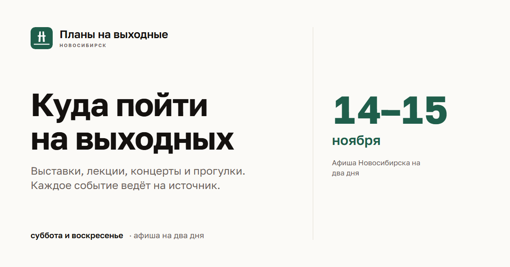

# Планы на выходные · Новосибирск



Каталог событий Новосибирска на ближайшие субботу и воскресенье: 19 площадок
собираются автоматически, анонсы сокращаются до двух предложений, афиши
подгружаются по ссылке источника. Там, где машинной афиши нет — парки с датами
на картинках, посты во «ВКонтакте», — событие вносится текстом и разбирается тем
же кодом. Публикация — дважды в неделю.

**Сайт:** https://photoalisa.github.io/plany-na-vyhodnye/

---

## Задача

Яндекс Афиша и крупные агрегаторы показывают коммерческий прокат и концерты звёзд.
Камерные выставки, лекции библиотек, встречи в креативных пространствах и поездки
за город остаются вне их поля зрения, хотя именно из них складываются планы на
выходные. Человек тратит вечер на обход десятка сайтов разной степени удобства.

Проект решает это так: собирает события из 19 источников, приводит их к одной схеме,
отбрасывает дубли и нерелевантное и отдаёт короткий каталог с быстрыми фильтрами
по житейским ситуациям — бесплатно, с детьми, с животными, прогулки и природа, за городом.

## Как устроено

```
19 источников → parsers/*.py → нормализация и дедупликация (common/*)
   → Google-таблица nsk_weekend → scripts/build_site.py → статический HTML
   → GitHub Actions → GitHub Pages
```

* **Сбор.** По модулю на источник: `parsers/cc19.py`, `parsers/ngonb.py`,
  `parsers/iskmuseum.py` и так далее. Парсер отдаёт сырые события и не разбирает
  даты — это делает ядро.
* **Нормализация.** `common/dates.py` понимает 16 форматов периодов, включая
  «постоянная экспозиция» и «каждую субботу». `common/text.py` чистит анонс,
  вытаскивает цену, определяет район и признаки фильтров.
* **Дедупликация.** Одно событие из нескольких источников попадает в каталог один раз.
* **Хранение.** Google-таблица `nsk_weekend` — единственный источник данных для сайта.
  Правка карточки не требует релиза кода.
* **Сборка.** `scripts/build_site.py` читает таблицу, фильтрует выходные и генерирует
  статические страницы: каталог, пять тематических подборок, раздел статей, 404,
  `sitemap.xml`, `robots.txt`, `llms.txt`.
* **Ручной контур.** `scripts/manual_add.py` берёт текст анонса из `content/manual/*.txt`
  и превращает его в строку таблицы: дата, время, площадка, цена, возраст, афиша,
  признаки фильтров. Повторная вставка обновляет строку, а не создаёт дубль.
  В облаке это делает workflow «Ручные события» — по загрузке текста и в еженедельном
  прогоне.
* **Публикация.** Три workflow: «Парсинг афиши» (пн и пт, 05:00 НСК), «Публикация
  сайта» (пн и пт, 09:00 НСК) и «Ручные события» (на загрузку текста). Четыре часа
  между сбором и публикацией — время посмотреть таблицу и поправить карточки.
  Время в расписании — ориентир: плановые прогоны GitHub ставит в очередь, поэтому
  публикацию в дни выпуска запускают кнопкой **Run workflow**, не дожидаясь 09:00.
* **Доступность.** Семантическая разметка с ориентиром `main`, ссылка «Перейти
  к содержимому», `alt` у афиш, заголовки `h1`/`h2`/`h3` по смыслу, озвучивание
  счётчика через `aria-live`, `aria-current` у подборок, видимый фокус с клавиатуры,
  контраст текста по WCAG AA.

## Схема таблицы `nsk_weekend` (31 колонка)

| Группа | Поля |
|---|---|
| Идентификация | `id`, `source` |
| Текст | `title`, `text_short`, `text_raw` |
| Даты | `date_raw`, `date_start`, `date_end`, `kind`, `time_text` |
| Место | `venue`, `address`, `district`, `geo_area` |
| Классификация | `category`, `tags` |
| Цена | `price_text`, `is_free` |
| Признаки фильтров | `is_child_ok`, `is_dog_ok`, `is_nature`, `is_outside_city`, `is_child_friendly` |
| Маркировка и доступность | `age`, `open_days` |
| Изображение | `image_url`, `image_ok` |
| Служебные | `source_url`, `status`, `parsed_at`, `checked_at` |

Служебные листы: `hidden` — скрытые вручную записи, `closures` — закрытия площадок
на дату или по дням недели (музей, который не работает в воскресенье, не должен
попадать в воскресную подборку).

Новые колонки добавляются только в конец — чтобы не сдвигать существующие данные.

## Что здесь есть

```
config.py                 реестр источников (имя, модуль, площадка, район, приоритет)
parser_main.py            запуск: сбор, дедупликация, запись в Google Sheets
check.py                  проверка без Google: что собрали и что отбросили
common/dates.py           разбор периодов и определение актуальности выходных
common/http.py            сессия, ретраи, дисковый кэш, параллельный обход, проверка картинок
common/text.py            очистка текста, цена, фильтры, районы, возрастная маркировка
common/model.py           модель события и схема таблицы
common/validate.py        валидация обязательных полей и доменов
common/sheets.py          upsert в Google Sheets, архив прошедших, лог прогонов
common/collect.py         параллельный запуск парсеров, дедупликация
common/closures.py        закрытия площадок: разовые даты и дни недели
common/articles.py        статьи: front-matter, разметка, текст
parsers/*.py              19 источников
scripts/build_site.py     генерация сайта из таблицы
scripts/hero_engraving.ps1 гравюры первого экрана корневой страницы из src/hero-refs
yandex-root/              корневая страница домена (первый экран), в сборку не входит
content/articles/*.md     статьи
static/                   файлы, попадающие в корень сайта (og.png, подтверждения сервисов)
.github/workflows/        расписание парсинга и публикации
```

## Запуск

```bash
pip install -r requirements.txt
playwright install chromium        # только для parsers/mega.py

python parser_main.py                 # собрать и обновить Google Sheets
python parser_main.py --csv           # только в out/nsk_weekend.csv, без Google
python parser_main.py --source ЦК19   # один источник
python parser_main.py --no-images     # без HEAD-проверки афиш (быстрее)
python parser_main.py --refresh       # игнорировать кэш страниц
python parser_main.py --close "<площадка>" вс   # закрыть площадку в воскресенье
python scripts/build_site.py --out public --base /plany-na-vyhodnye/ --sheet
```

`credentials.json` сервисного аккаунта Google кладётся в корень и в репозиторий
не попадает. В GitHub Actions он подставляется из секрета `GOOGLE_CREDENTIALS`.

## Как проверить, что всё работает

**Быстрая проверка без Google:**

```bash
python check.py --no-images
```

Ожидаемо: 16–19 источников, 130–180 сырых событий, 120–160 годных. Пустые
источники внизу — норма: у них может не быть событий на эти выходные.

**Один источник, когда что-то сломалось:**

```bash
python check.py --source kulturansk --sample 5
```

В консоли видно число карточек на странице и причины отказов. «Карточек: 0» —
поменялась вёрстка, правится селектор в `parsers/<источник>.py`.

**Данные глазами (важнее всего):** открыть `out/nsk_weekend.csv` и проверить, что
`date_end` не раньше `date_start`, `image_ok` не врёт, `price_text` согласован
с `is_free`, а `district` пустой там, где район не определён, а не «Центральный»
по умолчанию.

## Ограничения (известные и принятые)

* **Аура** отдаёт `ConnectionError` при частых запросах — модуль ходит по одной
  странице с паузой и пропускает источник при блокировке.
* **Музей Новосибирска** указывает только дату окончания выставки («до 31 декабря»):
  начало считаем от даты прогона, адрес и филиал разбираем из текста страницы.
* **Парки** публикуют расписание картинками — даты машинно не читаются, события
  вносятся текстом через `content/manual/` и разбираются тем же кодом.
* **Студия 84** — Tilda Zero Block без фида, разбор по тексту блоков; при смене
  вёрстки вернёт пусто.
* **МЕГА** требует Playwright.
* **Афиши** не хранятся у нас: ссылка проверяется HEAD-запросом, при 404/403
  карточка получает плейсхолдер.
* **Возрастная маркировка** берётся только из анонса источника. Часть площадок
  её не публикует, поэтому метка стоит не у всех карточек: достоверность важнее полноты.
* **Расписание GitHub Actions — «не раньше», а не «ровно».** Плановые прогоны идут
  через общую очередь: 9.11 парсинг стартовал в 08:18 вместо 05:00, 13.11 — в 09:17,
  а плановая публикация 13.11 не создалась совсем (ошибки при этом нигде не видно).
  Отсюда правило: в понедельник и пятницу проверять в Actions, был ли прогон, и при
  отсутствии запускать вручную.
* **Расписание GitHub Actions отключается** после 60 дней без коммитов
  в публичном репозитории — раз в месяц нужен «коммит-пульс» или ручной запуск.

## Правовая часть

* **152-ФЗ.** Сайт не собирает персональные данные: нет регистрации, личных
  кабинетов, форм с email и телефоном. Обратная связь — форма с единственным полем
  «ссылка на источник».
* **436-ФЗ.** Возрастная метка выводится в карточке, если источник её публикует.
* **Изображения.** Загружаются по внешней ссылке (hotlinking), на серверах сайта
  не хранятся; по жалобе правообладателя карточка правится или удаляется.
* **Информационное посредничество.** Карточка ведёт на страницу источника —
  сайт организатора, билетный сервис или сообщество — в новой вкладке
  (ст. 1253.1 ГК РФ).
* **Аналитика.** GoatCounter: без cookie, без идентификаторов посетителя, без
  хранения IP. Cookie-баннер и уведомление РКН не требуются.
* **Реклама.** На текущем этапе размещений нет, маркировка ОРД не требуется.

## Документы

* `docs/HANDOVER.md` — состояние проекта и ключевые решения
* `docs/site-build.md` — как собирается сайт
* `docs/site-plan.md` — структура сайта и визуальный язык
* `docs/google-sheets-setup.md` — настройка таблицы и сервисного аккаунта
* `docs/УСТАВ ПРОЕКТА ... V2.0.md` — цели, границы, риски, метрики

## Расширение

Новый источник — один файл `parsers/имя.py` с функцией `fetch()`, возвращающей
список словарей:

```python
{
    "title": "...",                        # обязательно
    "date_raw": "15 октября - 15 ноября",  # обязательно, строкой как на сайте
    "source_url": "https://...",           # обязательно
    "text_raw": "...",                     # обязательно, полный текст
    "image_url": "...", "venue": "...", "district": "...",
    "category": "...", "tags": "...", "price_text": "...", "kind_hint": "",
}
```

Даты, актуальность и фильтры считает ядро. Регистрация — строка в `SOURCES`
в `config.py`.

---

Некоммерческий пет-проект. Бюджет — 0 ₽: GitHub Pages, Google Sheets в бесплатных
квотах, GoatCounter на бесплатном тарифе.
